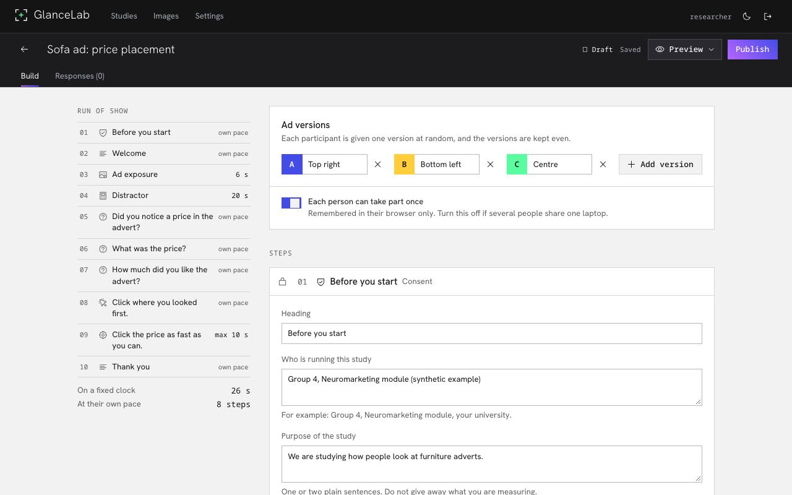
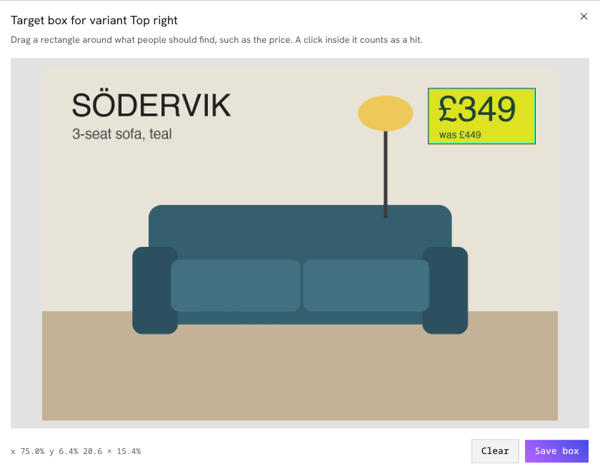
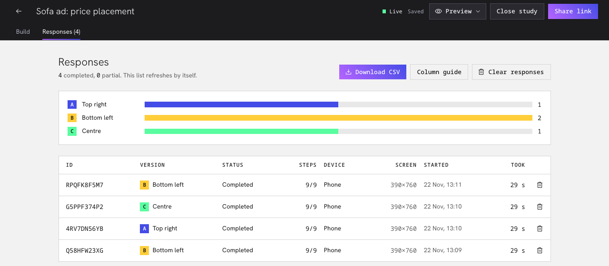
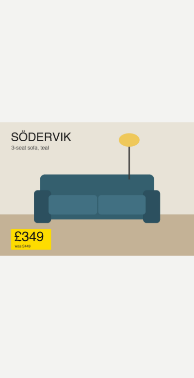
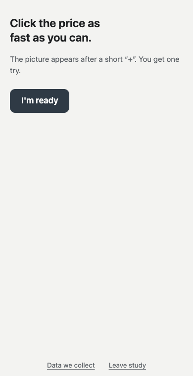
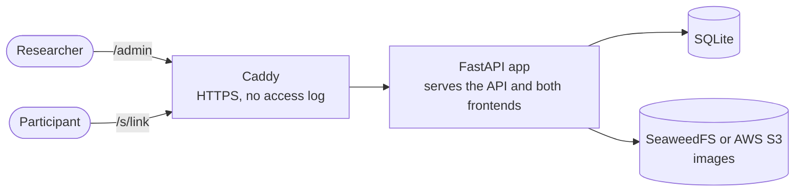
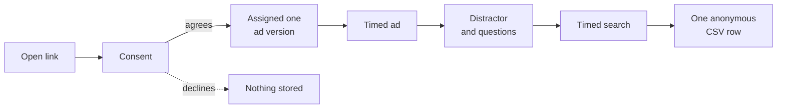

<div align="center">

# GlanceLab

**Run ad-variant studies from a form builder: a timed ad, an even random split, a "find the price" task, and an anonymous CSV at the end.**



</div>

## About

GlanceLab is a small web app built for a university neuromarketing study. The study asks one question: **does the position of a promo price in a static ad change whether people notice it, remember it and find it quickly?**

A researcher builds the study in an editor that works like Google Forms. Each participant opens a public link on a phone or laptop, with no login, and is shown **one** version of the ad for a fixed time. The researcher downloads one anonymous CSV row per participant.

## Features

- **Form builder** with seven step types: consent, text, ad exposure, distractor, question, click on image and timed search.
- **Balanced random assignment.** Each participant gets one ad version, and the versions are kept even.
- **Timed search.** Records the reaction time, the click position and whether the click landed in the target box you drew.
- **Shown once.** Refreshing or pressing Back never shows the ad again; that response is marked `interrupted`.
- **Preview, publish, share.** Try any version first, then share a link and QR code. After publishing, only wording can change.
- **Anonymous CSV** with a column guide that explains every column.

<table>
<tr>
<td width="50%"></td>
<td width="50%"></td>
</tr>
<tr>
<td align="center">Drawing the target box for a timed search</td>
<td align="center">Responses, with a live count per version</td>
</tr>
</table>

<div align="center">

&nbsp;&nbsp;

<br>
<sub>What participants see: the timed ad, then the search task</sub>
</div>

Every screen is in the [feature tour](docs/features.md).

## How it works



One container runs the API and serves both built frontends. Caddy sits in front for HTTPS. Images live in S3-compatible storage and are streamed through the app, so a participant's browser only ever talks to one origin.

A participant's run goes like this:



More detail, including the data model, is in [Architecture](docs/architecture.md).

## Privacy

- **No IP address** is stored or logged, by the app, uvicorn or Caddy.
- **No third parties.** Participant pages load everything from this server.
- **Nothing before consent.** "Leave study" deletes that person's data immediately.
- **Anonymous results.** A response carries only a random ID.

How each one is enforced: [docs/privacy.md](docs/privacy.md).

## Local development

You need Docker and [just](https://github.com/casey/just). One command builds and starts everything:

```bash
just up
```

| Part | Where |
|---|---|
| Admin panel, with hot reload | <http://localhost:5173/admin/> |
| Participant app, rebuilt on every change | study links, `http://localhost:5173/s/…` |
| Backend API | <http://localhost:8000> |

Log in with `researcher` and `local-dev-password`. The first build takes a few minutes.

```bash
just down           # stop, data is kept
just logs backend   # follow a service's logs
just check          # every test, lint and type check
just                # list all commands
```

The stack is defined in [`docker/compose/local.yml`](docker/compose/local.yml). The admin panel and the participant app are Compose profiles, so each can be started on its own with `just up-admin` or `just up-participant`. Without `just`:

```bash
docker compose -f docker/compose/local.yml --profile admin --profile participant up -d --build
```

More in [Development](docs/development.md).

## Deploying

On a server with Docker and a domain that points at it:

```bash
git clone <repository URL> glancelab && cd glancelab
cp .env.example .env        # then fill it in; the file explains each value
docker compose up -d --build
```

Then open `https://<your domain>/admin`. Caddy gets the HTTPS certificate by itself. The full walkthrough, with backups and AWS S3, is in [Deployment](docs/deployment.md).

## Documentation

| Document | What it covers |
|---|---|
| [Feature tour](docs/features.md) | Every screen of the admin panel and the participant flow |
| [Architecture](docs/architecture.md) | Components, data model, assignment, the shown-once rule |
| [API reference](docs/api.md) | Admin and participant endpoints, error format |
| [Results and CSV](docs/data-export.md) | Every CSV column and how to filter rows for analysis |
| [Privacy](docs/privacy.md) | What is collected and how the promises are kept |
| [Deployment](docs/deployment.md) | One EC2 instance step by step, configuration, backups |
| [Development](docs/development.md) | Local setup, checks, adding a step type |

## Tech stack

| Part | Built with |
|---|---|
| Backend | Python 3.12, FastAPI, SQLModel, Alembic, SQLite |
| Admin panel | React 19, TypeScript, Vite, Tailwind CSS, shadcn/ui |
| Participant app | TypeScript, Vite, jsPsych 8, fully self-hosted |
| Deployment | Docker Compose, Caddy, SeaweedFS or AWS S3 for images |
