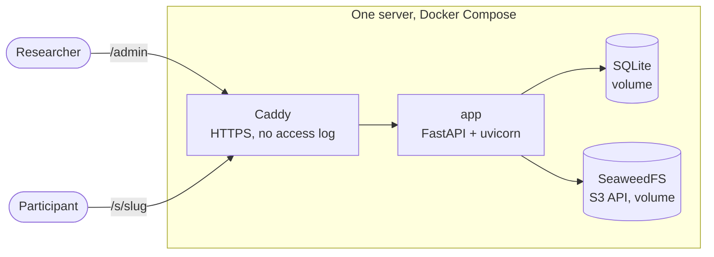
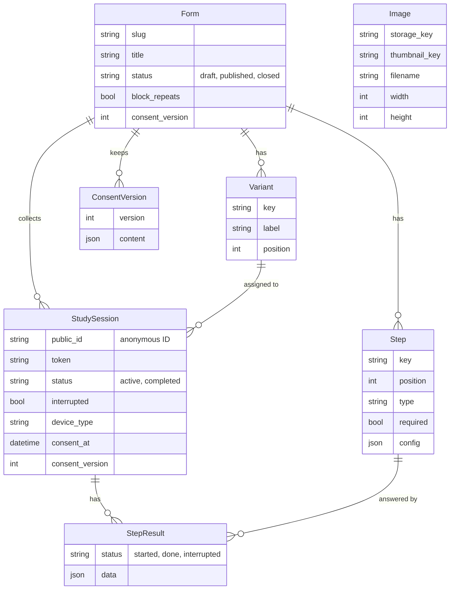
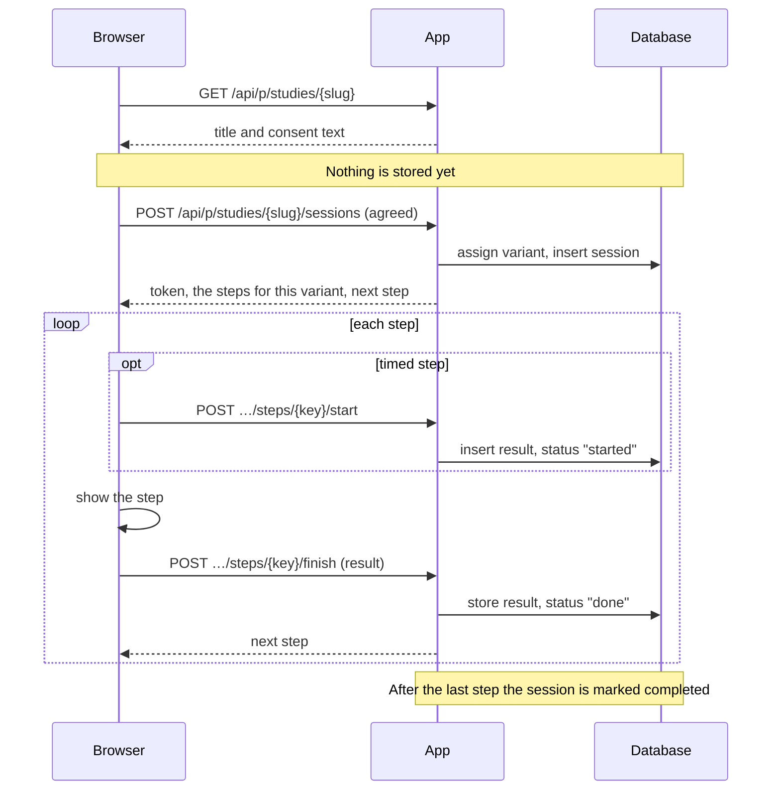

# Architecture

One process, one SQLite file, one admin. The structure is kept as small as the product.

- [Components](#components)
- [Backend layers](#backend-layers)
- [Data model](#data-model)
- [Step types](#step-types)
- [A participant's run](#a-participants-run)
- [Variant assignment](#variant-assignment)
- [The shown-once rule](#the-shown-once-rule)
- [Editing after publishing](#editing-after-publishing)
- [Images](#images)
- [Frontends](#frontends)

## Components



| Container | Role |
|---|---|
| `caddy` | Terminates HTTPS and gets the certificate. The only container reachable from outside. |
| `app` | The FastAPI backend. Also serves the two built frontends and streams images. |
| `seaweedfs` | S3-compatible image storage. Can be replaced by AWS S3 through settings alone. |

The app serves these paths:

| Path | What |
|---|---|
| `/admin`, `/admin/*` | The admin single-page app |
| `/s/{slug}` | The participant app for one study |
| `/api/admin/*` | Admin API, behind the login cookie |
| `/api/p/*` | Participant API, anonymous |
| `/img/{key}` | Images, streamed from storage |

## Backend layers

```
backend/app/
  main.py        app factory, error handler, security headers, frontend mounts
  settings.py    the only reader of the environment
  routers/       HTTP in, schema out
  services/      business rules and queries
  models/        SQLModel tables
  schemas/       Pydantic request, response and step-config models
  storage/       object storage client
```

Dependencies point one way: routers → services → models and storage.

| Layer | Does | Must not |
|---|---|---|
| Routers | Parse input, call one service function, return a schema | Hold business rules |
| Services | Business rules and queries, as plain functions taking a session | Import FastAPI, commit |
| Models | Tables | Contain behaviour |
| Schemas | Typed data crossing a boundary | Touch the database |
| Storage | Talk to S3 | Know about forms or sessions |

A few conventions follow from this:

- The request's database session commits on a clean exit and rolls back on an exception. Services never commit.
- Services raise the exceptions in `app/errors.py`. One handler in `main.py` turns them into responses.
- Handlers and services are synchronous `def` functions, because SQLite and boto3 both block. FastAPI runs them in its thread pool.
- SQLite runs in WAL mode with foreign keys on.

The full conventions are in [`.agents/rules/architecture.md`](../.agents/rules/architecture.md).

## Data model



- A **Form** is a study. In the user interface it is called a study.
- A **StudySession** is one participant's run. It is created only after consent. `public_id` is the anonymous ID in the CSV; `token` is the secret the participant's browser uses to continue.
- A **StepResult** holds what one step recorded, in a JSON column shaped by the step type.
- **Image** holds metadata only. The bytes are in object storage.

## Step types

A step's settings are a JSON column validated by a Pydantic discriminated union on `type`, in `app/schemas/steps.py`. There are seven types: `consent`, `text`, `stimulus`, `distractor`, `question`, `click_image` and `timed_search`. What the browser submits for each is typed the same way, in `app/schemas/results.py`.

Each config class names its *text fields*. Everything else is *structure*. That split drives the [editing rule](#editing-after-publishing).

A step type has five parts, and a new one needs all of them:

1. The config schema in `backend/app/schemas/steps.py`.
2. The participant plugin in `frontend/participant/src/plugins/`.
3. The editor card in `frontend/admin/src/editor/`.
4. The CSV columns in `backend/app/services/export.py`.
5. Tests for the schema and the export.

## A participant's run



The server decides which step comes next. A request for any other step is refused with `step_conflict`, so steps cannot be skipped or repeated from the browser.

The steps sent to a participant contain only their own version's images. They never include other versions, the target box, or how many versions exist. The server decides whether a search click was a hit.

## Variant assignment

`app/services/assignment.py`

1. Count the sessions of each version that are completed, or were last active within `ACTIVE_SESSION_MINUTES` (default 30).
2. Pick the version with the lowest count.
3. Break ties with a cryptographically secure random choice.

Counting and inserting the new session happen in one transaction, so two people who start at the same moment cannot both be counted from the same stale numbers. An abandoned session stops counting after the cutoff, and a later participant refills its slot.

The choice itself is a pure function, `choose_variant(counts, rng)`, tested with plain values.

## The shown-once rule

Three step types are timed: ad exposure, distractor and timed search. A participant must never see one twice, because a second look at the ad invalidates the memory measures.

- Before the browser shows a timed step, it calls `…/start`. The server stores a result with status `started`. Finishing a timed step that was never started is refused.
- When a page loads, the browser asks for the session state. Any result still `started` is closed as `interrupted`, the session is flagged `interrupted`, and the run continues with the next step.

So a refresh or the Back button costs the participant that step, and the row can be left out of the analysis.

## Editing after publishing

A form is `draft`, then `published`, then `closed`.

The editor saves the whole form in one request. Once a form is published or has responses, the server compares the *structure* of the saved and proposed content: version keys, step keys and order, required flags, and every non-text setting. If the structure differs, the save is refused with `form_locked`. Wording can still change.

This keeps the data comparable: every participant takes the same steps, and the CSV columns never shift.

Publishing itself is guarded by `app/services/readiness.py`, which returns plain-language reasons a form is not ready, such as a version without an image.

## Images

- Uploads are checked and resized with Pillow inside the request, and a thumbnail is made.
- Storage keys are generated by the server, never built from the uploaded filename.
- The same client code talks to SeaweedFS and AWS S3. The difference is settings.
- Browsers fetch images from the app at `/img/{key}`, never from the storage service.

## Frontends

| App | Stack | Notes |
|---|---|---|
| `frontend/admin` | React 19, TypeScript, Vite, Tailwind, shadcn/ui, dnd-kit, TanStack Query | A single-page app under `/admin`. The editor keeps a draft and autosaves it. |
| `frontend/participant` | TypeScript, Vite, jsPsych 8 | One plugin per step type. Everything is bundled; nothing is loaded from another site. |

Reaction times are measured in the participant's browser, from the moment the image is displayed to the click.
