# Feature tour

What GlanceLab does, in the order a researcher meets it. The screenshots use a made-up sofa ad with three price placements.

- [Studies](#studies)
- [Image library](#image-library)
- [The editor](#the-editor)
- [Ad versions](#ad-versions)
- [Step types](#step-types)
- [Preview](#preview)
- [Publish and share](#publish-and-share)
- [The participant's side](#the-participants-side)
- [Responses](#responses)
- [Settings and deletion](#settings-and-deletion)

## Studies

The first page after login lists every study with its status (draft, published or closed) and how many responses it has. From here you create a study, open one, duplicate it or delete it.

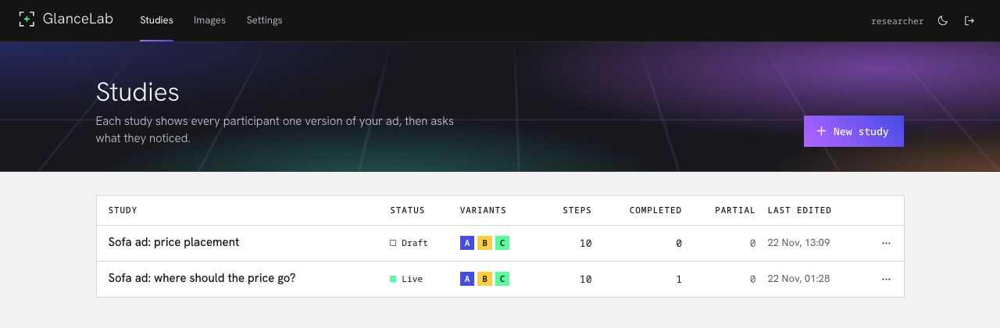

## Image library

Upload the ad images once and reuse them in any study. Images are resized on upload (longest edge 2400 px by default), and the page shows the total storage used. An image that a study uses cannot be deleted.

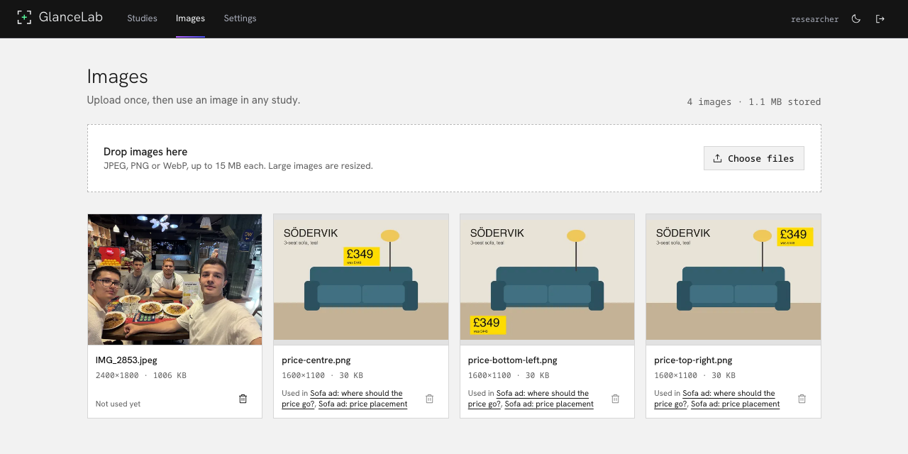

## The editor

A study is a list of steps. The left panel, the "run of show", lists them in order with their timings and adds up how long the fixed-clock steps take. Everything saves by itself.

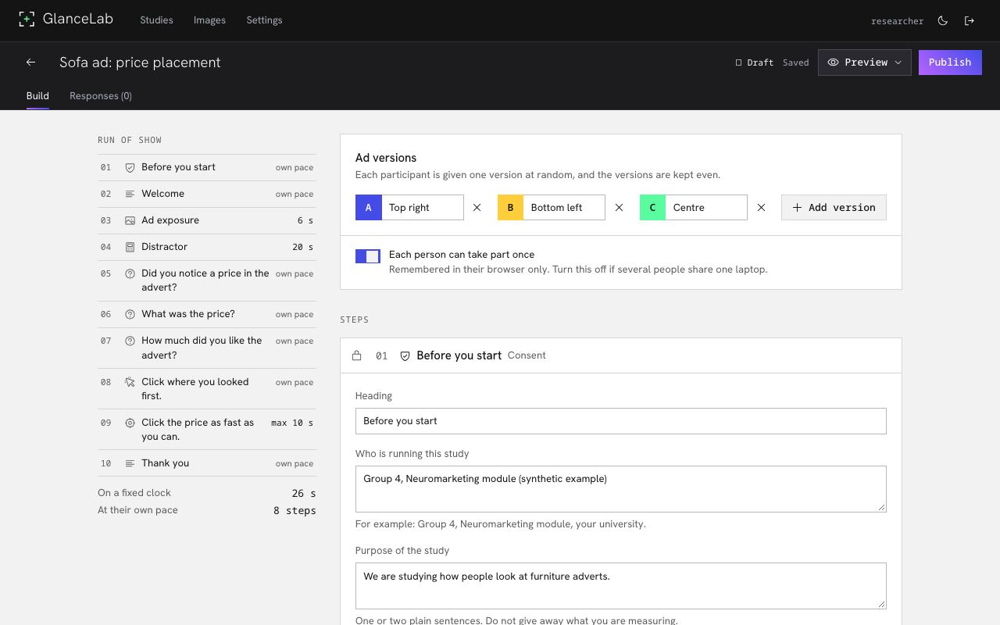

## Ad versions

Versions belong to the study, not to a step. A participant is given one version for the whole study, so the ad they see and the image they search later always match.

Assignment is random and balanced: a new participant gets the version with the fewest completed or recently active sessions, and ties are broken at random. Someone who started and left stops counting after 30 minutes, so their slot is refilled.

The switch below the versions controls whether one browser can take part more than once. Turn it off when several people share one laptop.

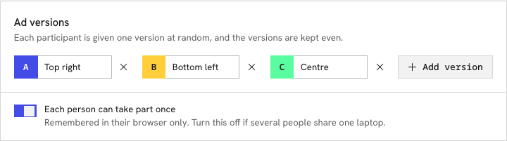

## Step types

**Add step** at the bottom of the editor offers the step types.

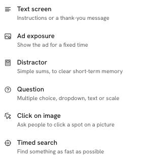

### Consent

Every study starts with a consent step. It can be reworded but not removed or moved. It states who runs the study, its purpose, what is and is not collected, that taking part is voluntary, and the date the data will be deleted. Each change to the wording is stored as a new version, and every response records which version that person saw.

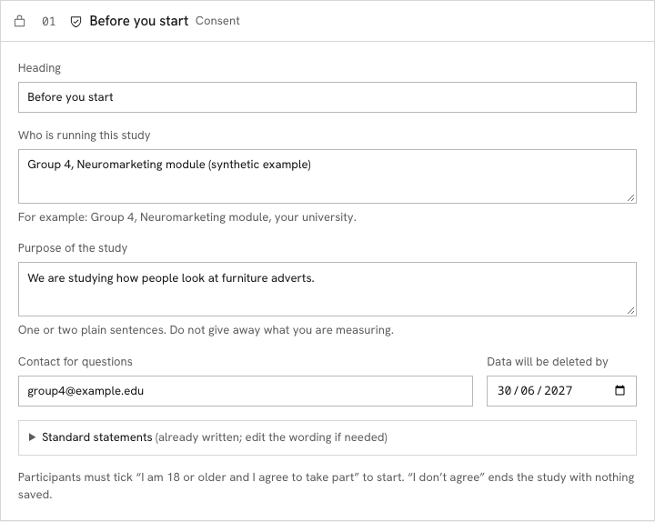

### Text screen

A title, formatted text and a button. Use it for the welcome, instructions and the thank-you page. Nothing is recorded.

### Ad exposure

Pick one image per version and set how long it stays on screen. The participant cannot pause or go back. The actual time on screen is recorded in milliseconds.

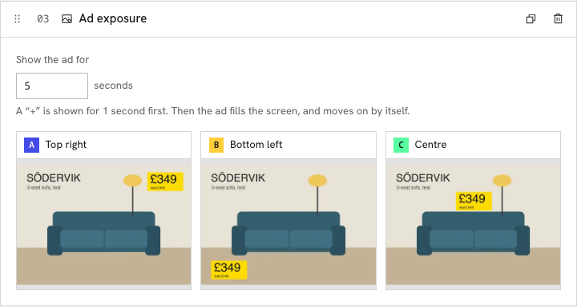

### Distractor

Simple sums for a fixed time. It clears short-term memory between the ad and the memory questions. The number of sums attempted and answered correctly is recorded.

### Question

Five kinds: multiple choice, dropdown, short answer, paragraph, and a numeric scale with labelled ends. Multiple choice can allow several answers and a free-text "Other". A question can be required or optional.

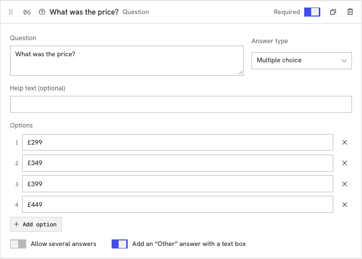

### Click on image

Shows one picture and asks the participant to click a spot, for example "Click where you looked first". The click position is recorded as fractions of the image, so it is comparable across screen sizes.

### Timed search

Shows the participant's ad version again and asks them to click a target as fast as they can. You pick the image per version and draw the target box on each.

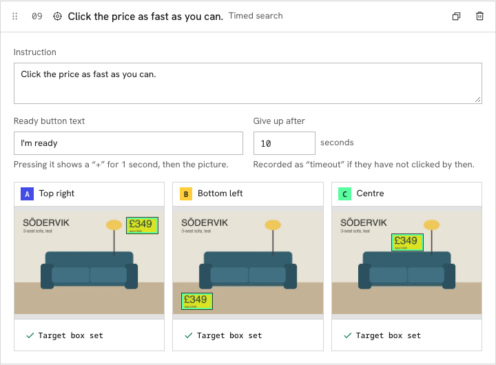

Drag a rectangle around the target. A click inside it counts as a hit. The step records the outcome (hit, miss, timeout or interrupted), the reaction time in milliseconds and the click position.

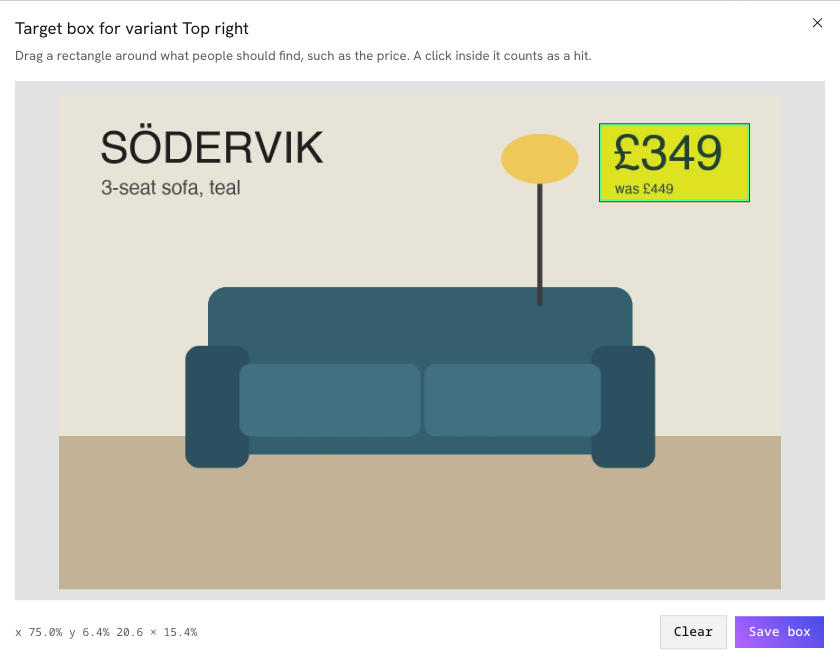

## Preview

Run the study as a participant would, in any version. Nothing is saved, so it is safe to repeat.

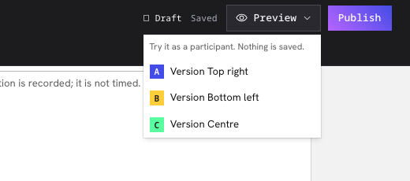

## Publish and share

Before publishing, the editor lists anything still missing: an empty consent field, a version without an image, a timed search without a target box, a question with fewer than two options. Once the list is empty, **Publish** gives a public link and a QR code.

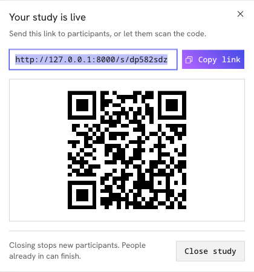

A published study accepts wording changes only. Steps, options, timings, images and versions are frozen, so every participant takes the same study and the CSV columns stay stable. To change the structure, duplicate the study, or close it and clear its responses.

## The participant's side

Participants open the link on a phone or laptop. There is no login.

<table>
<tr>
<td>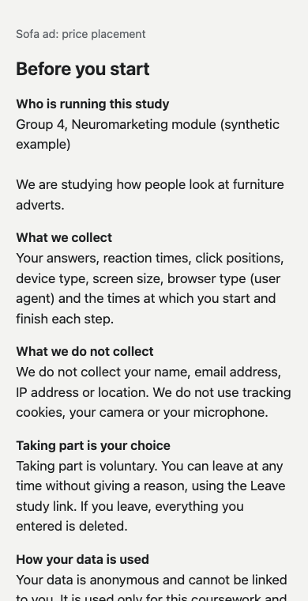</td>
<td>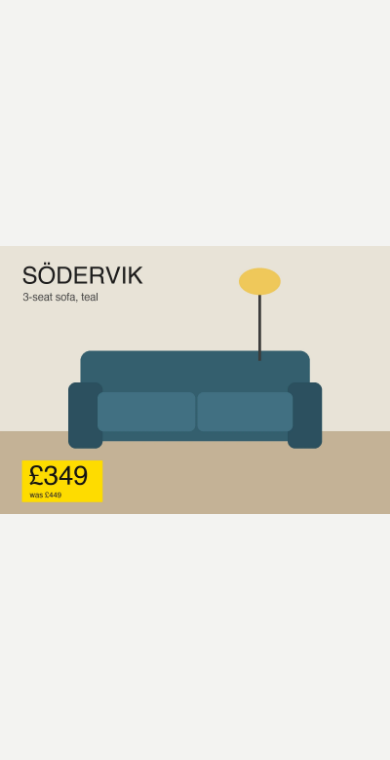</td>
<td>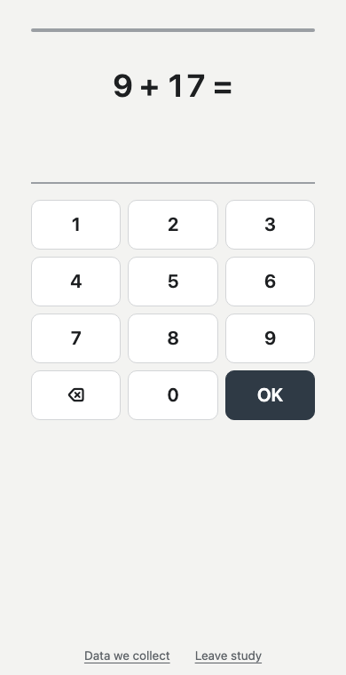</td>
<td>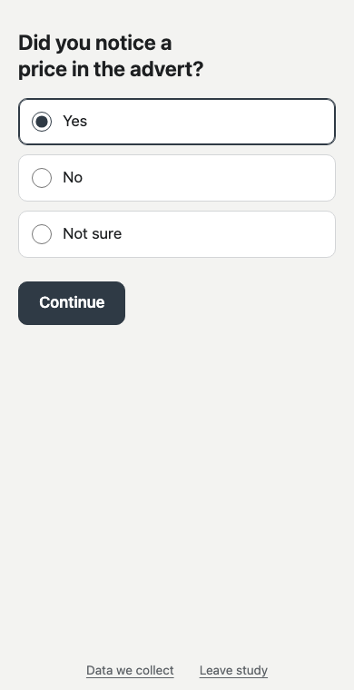</td>
<td>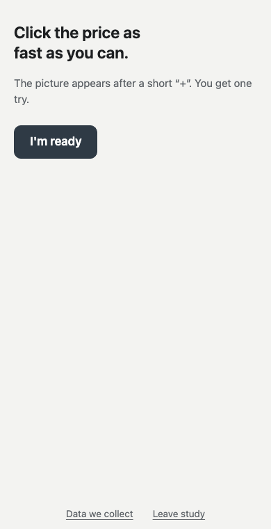</td>
</tr>
<tr>
<td align="center">Consent</td>
<td align="center">Ad, timed</td>
<td align="center">Sums</td>
<td align="center">Question</td>
<td align="center">Timed search</td>
</tr>
</table>

- Nothing is stored until the participant agrees. Declining writes nothing.
- A **Leave study** link is on screen from consent onward. Leaving deletes everything that person entered.
- If the page is reloaded during a timed step, that step is skipped and marked `interrupted`. The ad is never shown a second time.
- A reload during an untimed step continues where the participant left off.

## Responses

The **Responses** tab shows a live count per version and one row per participant. **Download CSV** gives the data, and **Column guide** gives a second CSV that explains every column and lists each question's wording. Single responses can be deleted here, and all responses of the study can be cleared.

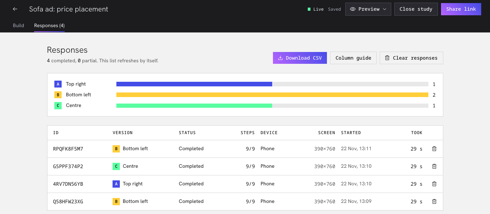

The columns are described in [Results and CSV](data-export.md).

## Settings and deletion

**Settings → Delete all data** removes every response, and optionally every study and image as well. It asks for a typed confirmation. All deletion in GlanceLab is permanent: rows are removed, not hidden.
